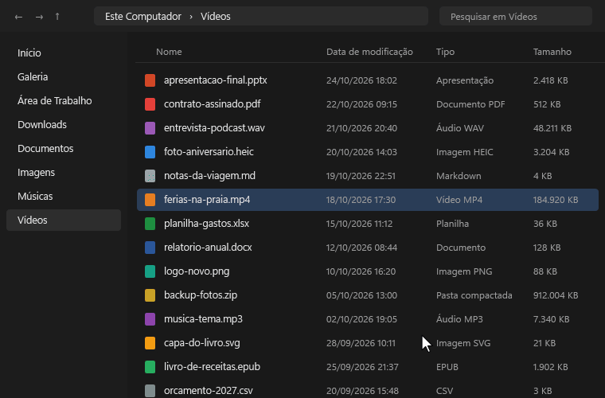

# RadialFlow

<p align="center">
  <a href="https://github.com/PedroBosa/RadialFlow/actions/workflows/ci.yml"></a>
  <a href="https://github.com/PedroBosa/RadialFlow/releases/latest"></a>
  <a href="LICENSE"></a>
  
  <a href="https://github.com/PedroBosa/RadialFlow/releases/latest"></a>
</p>

Um menu em forma de roda para o Windows. Segure o botão direito, arraste um pouco e a roda aparece embaixo do cursor.
Solte sobre uma opção e pronto.

<p align="center">
  
</p>

**Neste guia:** [O que a roda faz](#o-que-a-roda-faz) · [Instalar](#instalar) · [Configurar](#configurar) · [Menus](#menus-personalizados) · [Converter](#converter-arquivos) · [Problemas](#problemas-comuns) · [Desinstalar](#desinstalar) · [Desenvolvedores](#para-desenvolvedores) · [Segurança](#segurança) · [Licença](#licença)

## O que a roda faz

As opções mudam conforme o que está embaixo do cursor; o clique direito sem arrastar continua abrindo o menu de
sempre do Windows.

| Onde você abre a roda | O que aparece |
|---|---|
| Um arquivo ou pasta | Comprimir, Converter (só quando possível), Copiar caminho, Mover para, Enviar para, Renomear |
| Barra de título de uma janela | Maximizar, encaixar à esquerda ou à direita, Transparência, Sempre no topo, Minimizar, Fechar |
| Um campo de texto | Colar, Traduzir, Pesquisar, Negrito, Limpar |
| Área de trabalho ou espaço vazio | Apps favoritos, Ajustes rápidos do Windows, Histórico da área de transferência, Bloquear |

Opções com setinha ⌄, como **Converter**, abrem mais escolhas se você deixar o cursor parado sobre elas; para voltar,
pare no centro da roda.

Com a roda aberta, **1–8** escolhem a opção pela posição (1 no topo, em sentido horário), as **setas** circulam,
**Enter** abre o submenu ou executa e **Esc** volta ou fecha; os atalhos valem só enquanto ela está na tela.

Se preferir não arrastar, grave um **atalho global** em **Configurações → Geral**, como `Ctrl+Alt+Space`: a roda abre
no cursor e se escolhe com um **clique**, o miolo volta um nível e um clique fora fecha. O botão direito, o **Esc** ou
o próprio atalho fecham sem escolher; ele vale também na Blacklist e em tela cheia, exceto com o app pausado.

## Instalar

1. Baixe o `RadialFlow-<versão>-Setup.exe` na página **Releases** deste repositório.
2. Abra o arquivo, siga o assistente e, no fim, deixe marcado **Abrir o RadialFlow agora**; o programa fica em
   `C:\Program Files\RadialFlow`.
3. Na página de tarefas, marque os **conversores** que quiser; o FFmpeg já vem marcado.

Ele fica no canto da barra de tarefas, perto do relógio; se não aparecer, clique na setinha **^**. Clique para abrir
as configurações; o botão direito pausa ou fecha. Ele pede permissão de administrador sempre que abre — é isso que
deixa a roda funcionar em cima de janelas do sistema, como o Gerenciador de Tarefas.

Prefere não instalar? Extraia **todos** os arquivos do `RadialFlow-<versão>-win-x64.zip` numa pasta e abra o
`RadialFlow.exe`; o instalador ainda é recomendado: fica numa pasta que outros programas não alteram.

### O Windows protegeu o computador

Na primeira vez, o Windows pode mostrar **"O Windows protegeu o computador"**: o RadialFlow não tem assinatura
digital — um certificado pago que identifica quem fez o programa —, e isso não quer dizer que ele tenha vírus.
Clique em **Mais informações** e **Executar assim mesmo**; quando o Windows perguntar, mostrando **Editor:
Desconhecido**, clique em **Sim**.

O aviso pode voltar a cada versão; para conferir o download, compare o hash com o do `SHA256SUMS.txt`:

```powershell
Get-ChildItem .\RadialFlow-*-Setup.exe | Get-FileHash
```

## Configurar

Clique no ícone do RadialFlow perto do relógio.

- **Geral**: iniciar com o Windows, pausar em tela cheia, o arrasto e o tempo das opções extras, e o atalho global.
- **Aparência**: cor de destaque, idioma — português, inglês ou espanhol — e o estilo da roda: **Padrão**,
  **Compacto**, **Amplo** ou **Alto contraste**. O estilo muda o tamanho e a legibilidade; o **Alto contraste** usa
  superfícies opacas, contornos fortes e o tema claro/escuro do Windows, sem o fundo desfocado. O idioma vale a partir
  do próximo início.
- **Blacklist**: programas em que a roda nunca abre (útil em programas 3D e jogos, que usam o botão direito).
- **Apps favoritos**: os atalhos que aparecem quando você abre a roda na área de trabalho.
- **Menus**: itens extras para certos aplicativos, janelas ou contextos (veja abaixo).
- **Conversores**: instala os programas de conversão.

**Salvar** só fecha a janela depois de gravar o arquivo; se a gravação falhar, um aviso explica e nada é aplicado.
Fechar com alterações não salvas pede confirmação e lista as seções.

## Menus personalizados

Além das opções automáticas, crie menus em **Configurações → Menus**. Cada um vale só onde você escolher e **soma**
seus itens à roda do contexto. Clique em **Novo**, dê um nome e preencha as condições (todas opcionais):

- **Processo**: o aplicativo onde o menu vale, sem o `.exe` (por exemplo, `notepad`); vazio vale para todos.
- **Título contém**: um trecho do título da janela (como o nome de uma aba); vazio vale para todos.
- **Extensões**: só com arquivos desses tipos, como `.pdf, .docx`; vazio vale para todos.
- **Classe da janela**: a classe técnica da janela (como `CabinetWClass`, do Explorer), para alvos que o processo e o
  título não distinguem; vazio vale para todos.
- **Contextos**: arquivos e pastas, área de trabalho, barra de título, campos de texto ou genérico; nenhum vale para todos.
- **Prioridade**: com vários menus ao mesmo tempo, todos entram; ela decide a ordem quando falta espaço na roda.

Depois, adicione os itens. Cada um pode ser:

| Tipo | O que faz | Observação |
|---|---|---|
| Ação do RadialFlow | Executa uma opção que já existe | Assume o lugar da fatia automática equivalente. |
| Abrir executável | Abre um programa | Só de pastas protegidas e sem argumentos. |
| Abrir site | Abre um site | Só `http://` e `https://`. |
| Abrir arquivo ou pasta | Abre com o programa padrão | Executáveis, scripts e atalhos são recusados. |
| Enviar atalho | Envia teclas, como `Ctrl+Shift+P` | Foco na janela onde a roda abriu. |
| Colar texto | Cola um texto no campo em foco | Devolve o conteúdo anterior depois. |
| Transformar texto | Muda a seleção: maiúsculas, minúsculas, título, frase, sem espaços sobrando ou em uma linha | Copia a seleção, transforma e cola por cima. |
| Rotina | Até 8 passos em sequência, com pausas | Abrir outra janela só no último passo. |
| Submenu | Segundo anel com até 8 opções | 2 a 8 opções, exceto submenu e rotina. |

**Submenus** funcionam como **Apps favoritos**: a fatia mostra ▾ e você a segura para abrir um segundo anel com 2 a 8
opções montadas em **Editar opções…** (rótulo, ícone e ação). A **prévia da roda** marca as fatias do seu menu como
**substitui** (ocupou o lugar de uma automática) ou **extra** (acrescentada): a roda cabe no máximo **8 fatias**, o
que não couber fica de fora, e a prévia avisa quantos itens serão ignorados. São até 8 itens por menu e até 20 menus.
**Rotinas** encadeiam até 8 passos — ações do RadialFlow ou pausas de 50 a 2.000 ms (até 5 s) —, e ações que abrem
outra janela, como **Pesquisar**, só podem ser o último; em **Editar passos…** você monta a sequência, e a prévia
avisa se ela ficar inválida.

Cada menu aceita um **atalho próprio** (como `Ctrl+Alt+1`): ele abre a roda direto com os itens do menu, no cursor e
sem exigir as condições, desde que o menu esteja ativo e tenha ao menos um item. O atalho não pode repetir o atalho
global nem o de outro menu, e importar menus recusa o arquivo inteiro se um atalho for inválido ou repetido.

Salvar vale para o próximo menu aberto; para voltar à roda automática, desative ou remova o menu. **Importar…** e
**Exportar…** trocam somente os menus, num `.json` versionado: importar **acrescenta** cópias ao rascunho — a edição
que só vale depois de **Salvar** —, desempata nomes com “(importado)” e recusa o arquivo inteiro se algo infringir as
regras; exportar grava o rascunho, inclusive alterações não salvas. Os
itens externos rodam sem administrador; os limites estão em [Segurança](#segurança). Exemplo: um menu com processo
`notepad` e **Abrir executável** → `notepad.exe` só no Bloco de Notas.

## Converter arquivos

Abra a roda sobre um arquivo e segure em **Converter**: aparecem só os formatos que funcionam para ele neste
computador; se nenhum funcionar, a opção nem aparece. Quando há mais de 8 formatos, a última opção vira
**Mais…** e abre a página seguinte, na mesma ordem. O arquivo novo fica na mesma pasta e nada é sobrescrito: se já
existir um, vira `nome (1).ext`. PDF não pode ser convertido para outros formatos.

| Arquivo | Vira | O que precisa |
|---|---|---|
| Imagem PNG, JPG, BMP, GIF, TIFF, ICO | PNG, JPG, PDF, ICO, GIF, BMP, TIFF | nada |
| Foto WebP, HEIC, AVIF ou RAW de câmera | os mesmos formatos acima | extensões de Imagem HEIF, Imagem da Web e Imagem Bruta da Microsoft Store (o Windows 11 já costuma ter) |
| Imagem para HEIC | HEIC | Extensões HEIF e de Vídeo HEVC |
| Imagem para WEBP, SVG e outros | WEBP e outros | [ImageMagick](https://imagemagick.org) |
| Vídeo | MP4, MKV, WEBM, MOV, GIF animado, MP3, M4A, WAV | [FFmpeg](https://ffmpeg.org) |
| Áudio | MP3, M4A, WAV, FLAC, OGG, OPUS, AAC, AIFF | FFmpeg |
| Word, ODT, RTF, TXT, HTML | PDF, DOCX, ODT, RTF, HTML | [LibreOffice](https://www.libreoffice.org) |
| Markdown, EPUB (e Word ou HTML) | DOCX, HTML, ODT, RTF, EPUB, Markdown, TXT; PDF com o LibreOffice junto | [Pandoc](https://pandoc.org) |
| Planilha (Excel, ODS, CSV) | PDF, XLSX, ODS, CSV | LibreOffice |
| Apresentação (PowerPoint, ODP) | PDF, PPTX, ODP | LibreOffice |

### Instalar os conversores

O RadialFlow instala os conversores gratuitos (FFmpeg, Pandoc, ImageMagick e LibreOffice) escolhidos no **instalador**
ou em **Configurações → Conversores**. Os arquivos vêm do site oficial, numa versão fixa, e só são instalados se o
SHA-256 conferir. Precisa de internet; o LibreOffice tem cerca de 360 MB e não substitui o Word ou o Excel.

O FFmpeg sai na desinstalação; os outros viram programas normais, listados em **Aplicativos instalados**.
Se instalar por conta própria, use uma pasta protegida, como `C:\Program Files`. Pelo
[winget](https://learn.microsoft.com/windows/package-manager/winget/), `--scope machine` vale para todos os usuários
— sem isso, o FFmpeg vai para a pasta do usuário e é ignorado.

## Problemas comuns

**A roda não abre.** Veja se o ícone está perto do relógio e se o RadialFlow não está pausado. Ela também não abre
em tela cheia nem na Blacklist, e é preciso arrastar um pouco.

**O atalho global não funciona.** Outro programa pode já usar a combinação: as Configurações avisam ao gravá-la e não
salvam enquanto o conflito existir. Com o app pausado ele fica desligado; se for tomada depois, grave outra.

**A opção Converter não aparece, ou não tem o formato que eu queria.** Falta o programa que faz a conversão (veja a
tabela): instale-o em **Configurações → Conversores**. Não precisa reiniciar, espere um minuto.

**A instalação de um conversor falhou.** A janela diz o motivo (sem internet, outra instalação em andamento...).
Tente pela aba Conversores; o registro fica na pasta de logs (**Sobre → Abrir pasta de logs**).

**Abri o RadialFlow de novo e só apareceram as configurações.** É o esperado: ele já estava aberto. Só uma cópia
roda por vez.

**O ícone sumiu do canto da barra de tarefas.** Clique na setinha **^** ao lado do relógio; se foi fechado, abra-o
pelo menu Iniciar.

**Algo deu errado e eu quero saber o quê.** Na aba **Sobre**, clique em **Abrir pasta de logs**: o `radialflow.log`
registra o que aconteceu e os erros.

## Desinstalar

Abra **Configurações do Windows → Aplicativos → Aplicativos instalados**, procure **RadialFlow** e clique em
**Desinstalar**. O desinstalador fecha o programa, remove a inicialização com o Windows e apaga o FFmpeg baixado;
Pandoc, ImageMagick e LibreOffice continuam como programas próprios. Suas configurações e os logs ficam em
`%LocalAppData%\RadialFlow`, caso você instale de novo — para apagar tudo, exclua a pasta.

## Para desenvolvedores

### Preparar o ambiente

- Windows 10 ou 11 com o [.NET 10 SDK](https://dotnet.microsoft.com/download)
- [Inno Setup 6](https://jrsoftware.org/isinfo.php), só para gerar o instalador

```powershell
dotnet build              # app, testes e gerador de ícone; qualquer aviso conta como erro
dotnet test               # todos os testes
```

Para rodar, abra `src\RadialFlow\bin\Debug\net10.0-windows\RadialFlow.exe` como administrador; o `dotnet run` falha com o erro 740.

### Gerar os arquivos de distribuição

```powershell
powershell -ExecutionPolicy Bypass -File .\publish.ps1
```

O script roda os testes e, se passarem, cria `dist\` (fora do Git) com o `.zip` portátil, o instalador `Setup.exe`
(Inno Setup) e o `SHA256SUMS.txt`; a pasta `RadialFlow-<versão>-win-x64\` que os dois empacotam é apagada no fim
(use `-KeepStaging` para mantê-la). O README, o CHANGELOG, a licença e `docs\` vão dentro do zip e do instalador.

A versão vem do `<Version>` em `src\RadialFlow\RadialFlow.csproj`; o script falha se o `#define AppVersion` do
`RadialFlow.iss` divergir. Feche o RadialFlow antes do script: aberto a partir de `bin\`, ele trava o `.exe`.

**Assinatura digital (opcional).** Sem certificado, o Windows mostra o aviso do SmartScreen. Com um certificado
instalado, informe a impressão digital e o script assina tudo, com carimbo de tempo (ou defina
`RADIALFLOW_SIGN_THUMBPRINT`; use o `signtool.exe` do Windows SDK):

```powershell
.\publish.ps1 -CertThumbprint "<impressão digital do certificado>"
```

### Ícone

O ícone é desenhado pelo código, com a geometria da roda (`src/RadialFlow/UI/Tray/AppIconRenderer.cs`); depois de mudar
o desenho, gere-o com `dotnet run --project tools/IconGenerator`. Um teste falha se
`src/RadialFlow/Assets/RadialFlow.ico` divergir.

### Como o código está organizado

| Pasta | O que tem |
|---|---|
| `src/RadialFlow/Input/` | o hook do mouse e a blacklist |
| `src/RadialFlow/Context/` | descobre o que está sob o cursor e executa as ações |
| `src/RadialFlow/Services/` | conversão, instalação de conversores, compactação e lançamento de programas sem administrador |
| `src/RadialFlow/Security/` | validação de caminhos e de executáveis |
| `src/RadialFlow/Config/` e `src/RadialFlow/Infrastructure/` | configurações, log, instância única e versão |
| `src/RadialFlow/UI/` | a roda, as janelas, a bandeja e o tema |
| `tests/RadialFlow.Tests/` | os testes, na mesma organização do app |
| `tools/IconGenerator/` | gera o `src/RadialFlow/Assets/RadialFlow.ico` |

## Segurança

O RadialFlow roda como administrador e mexe em arquivos e programas de outros, então toma alguns cuidados:

- Os conversores (FFmpeg e outros) **nunca** rodam como administrador; sem esse modo, a conversão é recusada.
- Só executa programas de pastas que um usuário comum não consegue alterar — `C:\Program Files`, por exemplo.
- Os conversores vêm de endereços fixos dos sites oficiais, só por HTTPS, e são baixados numa pasta protegida; nada
  instala se tamanho ou SHA-256 não conferirem.
- Todo caminho é conferido antes de ser usado: nada de `..`, nomes reservados do Windows ou truques com `:`.
- Os itens dos menus não ganham novos poderes: executáveis só de pastas protegidas, sem argumentos nem
  interpretadores (`cmd`, PowerShell, `wscript`); sites só `http`/`https`; executáveis, scripts e atalhos recusados
  em **Abrir arquivo ou pasta**; apps de `%LocalAppData%` fora de **Abrir executável** (use **Apps favoritos**).
  Tudo roda sem administrador.
- Nada é sobrescrito sem perguntar: se já existe um arquivo com o mesmo nome, o novo vira `nome (1).ext`.

As mudanças de cada versão estão no [CHANGELOG](CHANGELOG.md).

## Licença

[MIT](LICENSE) © 2026 Pedro Bosa. Você pode usar, copiar, modificar e distribuir o RadialFlow, desde que mantenha o
aviso de copyright e a licença. Os conversores (FFmpeg, Pandoc, ImageMagick e LibreOffice) são programas à parte,
com licenças próprias; o RadialFlow não os inclui, só os baixa dos sites oficiais quando você pede.
