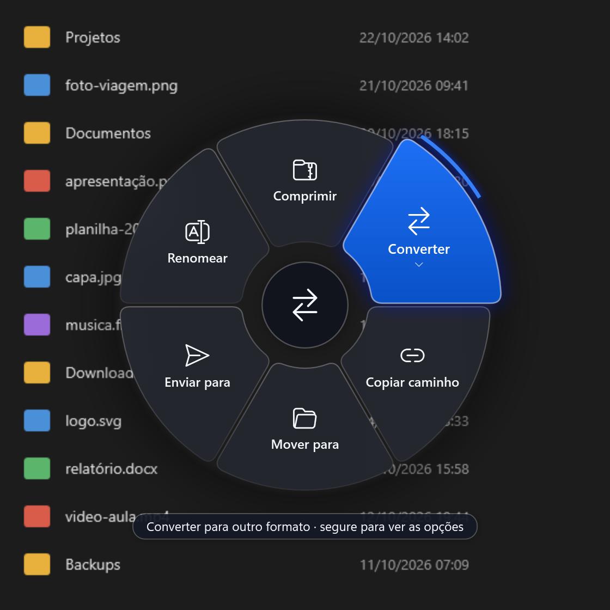

# RadialFlow

Um menu em forma de roda para o Windows. Segure o botão direito do mouse, arraste um pouco e a roda aparece
embaixo do cursor. Solte sobre uma opção e pronto.



As opções mudam conforme o que está embaixo do cursor:

| Onde você abre a roda | O que aparece |
|---|---|
| Um arquivo ou pasta | Comprimir, Converter (só quando há para o que converter), Copiar caminho, Mover para, Enviar para, Renomear |
| A barra de título de uma janela | Maximizar, encaixar à esquerda ou à direita, Transparência, Sempre no topo, Minimizar, Fechar |
| Um campo de texto | Colar, Traduzir, Pesquisar, Negrito, Limpar |
| A área de trabalho ou um espaço vazio | Apps favoritos, Ajustes rápidos (as Configurações rápidas do Windows), Histórico da área de transferência, Bloquear |

O clique direito normal, sem arrastar, continua abrindo o menu de sempre do Windows.

Algumas opções, como **Converter**, têm uma setinha ⌄. Deixe o cursor parado sobre elas: um traço azul vai se
completando na borda e, quando fecha, aparecem mais opções (os formatos de conversão, por exemplo). Para voltar,
deixe o cursor parado no centro da roda: um círculo se completa em volta do botão e a roda volta ao menu anterior.

## Instalar

1. Baixe o `RadialFlow-1.2.0-Setup.exe` na página **Releases** deste repositório.
2. Abra o arquivo e siga o assistente. O RadialFlow é instalado em `C:\Program Files\RadialFlow`.
3. Na página de tarefas, marque os **conversores** que quiser (veja [Converter arquivos](#converter-arquivos)). O
   FFmpeg, para vídeo e áudio, já vem marcado. Dá para instalar os outros depois.
4. No fim, deixe marcado **Abrir o RadialFlow agora**.

Ele fica no canto da barra de tarefas, perto do relógio (o ícone é uma rodinha). Se não estiver aparecendo, clique
na setinha **^** ao lado do relógio. Clicando no ícone você abre as configurações; com o botão direito, pode pausar
ou fechar o programa.

O RadialFlow pede permissão de administrador sempre que abre. É isso que deixa a roda funcionar também em cima de
janelas do sistema, como o Gerenciador de Tarefas.

Prefere não instalar? Existe também a versão portátil (`RadialFlow-1.2.0-win-x64.zip`). Extraia **todos** os
arquivos numa pasta e abra o `RadialFlow.exe`. O instalador continua sendo a opção recomendada, porque coloca o
programa numa pasta que outros programas não conseguem alterar.

### O Windows protegeu o computador

Na primeira vez, o Windows pode mostrar uma tela azul dizendo **"O Windows protegeu o computador"**. Isso acontece
porque o RadialFlow não tem assinatura digital (um certificado pago que identifica quem fez o programa), então o
Windows avisa por precaução. Não quer dizer que ele tenha vírus.

Para continuar:

1. Clique em **Mais informações**.
2. Clique em **Executar assim mesmo**.

Logo depois, o Windows pergunta se o programa pode fazer alterações, mostrando **Editor: Desconhecido**. Clique em
**Sim**.

O aviso pode aparecer de novo a cada versão nova. Se quiser conferir se o arquivo que você baixou é o original,
compare o hash dele com o do arquivo `SHA256SUMS.txt` publicado junto:

```powershell
Get-FileHash .\RadialFlow-1.2.0-Setup.exe
```

## Configurar

Clique no ícone do RadialFlow perto do relógio.

- **Geral**: iniciar com o Windows, pausar em jogos e vídeos em tela cheia, quanto é preciso arrastar para a roda
  abrir, quanto tempo esperar para as opções extras aparecerem e a cor da roda.
- **Blacklist**: programas em que a roda nunca abre (útil em programas 3D e jogos, que usam o botão direito).
- **Apps favoritos**: os atalhos que aparecem quando você abre a roda na área de trabalho.
- **Conversores**: instala os programas de conversão (veja abaixo).

## Converter arquivos

Abra a roda sobre um arquivo e segure em **Converter**: aparecem só os formatos que funcionam para aquele arquivo
neste computador. Se nenhum funcionar, a opção Converter não aparece. O arquivo novo fica na mesma pasta, e nada é
sobrescrito: se já existir um com o mesmo nome, o novo vira `nome (1).ext`.

| Arquivo | Vira | O que precisa |
|---|---|---|
| Imagem PNG, JPG, BMP, GIF, TIFF, ICO | PNG, JPG, PDF, ICO, GIF, BMP, TIFF | nada |
| Foto WebP, HEIC, AVIF ou RAW de câmera | os mesmos formatos acima | as extensões gratuitas **Extensões de Imagem HEIF**, **Extensões de Imagem da Web** e **Extensão de Imagem Bruta** da Microsoft Store (o Windows 11 geralmente já tem) |
| Imagem para HEIC | HEIC | Extensões de Imagem HEIF e Extensões de Vídeo HEVC |
| Imagem para WEBP, ou SVG e outros formatos | WEBP e os demais | [ImageMagick](https://imagemagick.org) |
| Vídeo | MP4, MKV, WEBM, MOV, GIF animado, MP3, M4A, WAV | [FFmpeg](https://ffmpeg.org) |
| Áudio | MP3, M4A, WAV, FLAC, OGG, OPUS, AAC, AIFF | FFmpeg |
| Word, ODT, RTF, TXT, HTML | PDF, DOCX, ODT, RTF, HTML | [LibreOffice](https://www.libreoffice.org) |
| Markdown, EPUB (e Word ou HTML para Markdown, EPUB ou TXT) | DOCX, HTML, ODT, RTF, EPUB, Markdown, TXT; PDF com o LibreOffice junto | [Pandoc](https://pandoc.org) |
| Planilha (Excel, ODS, CSV) | PDF, XLSX, ODS, CSV | LibreOffice |
| Apresentação (PowerPoint, ODP) | PDF, PPTX, ODP | LibreOffice |

PDF não pode ser convertido para outros formatos.

### Instalar os conversores

FFmpeg, Pandoc, ImageMagick e LibreOffice são programas gratuitos. O RadialFlow instala os que você escolher, de
dois jeitos:

- **no instalador**, na página de tarefas;
- **depois**, em **Configurações → Conversores**: marque e clique em **Instalar selecionados**.

Os arquivos vêm do site oficial de cada programa, numa versão fixa, e só são instalados se a impressão digital
(SHA-256) conferir com a esperada. Precisa de internet. O LibreOffice é grande (cerca de 360 MB) e pode levar alguns
minutos; ele não toma o lugar do Word ou do Excel para abrir seus arquivos.

O FFmpeg fica dentro da pasta do RadialFlow e sai junto quando você o desinstala. Pandoc, ImageMagick e LibreOffice
viram programas normais do Windows: aparecem em **Aplicativos instalados** e são desinstalados por lá.

Se preferir instalar por conta própria, eles precisam estar numa pasta protegida, como `C:\Program Files`, onde os
instaladores deles colocam por padrão. Pelo [winget](https://learn.microsoft.com/windows/package-manager/winget/),
instale para todos os usuários:

```powershell
winget install --scope machine Gyan.FFmpeg
winget install --scope machine ImageMagick.ImageMagick
winget install --scope machine JohnMacFarlane.Pandoc
winget install --scope machine TheDocumentFoundation.LibreOffice
```

Sem `--scope machine`, o winget instala o FFmpeg na sua pasta de usuário, e o RadialFlow o ignora por segurança.

## Problemas comuns

**A roda não abre.** Veja se o ícone está perto do relógio e se não está pausado (cinza). A roda também não abre em
jogos e vídeos em tela cheia, nem nos programas da Blacklist. E é preciso arrastar um pouco: um clique parado abre o
menu normal do Windows.

**A opção Converter não aparece, ou não tem o formato que eu queria.** Falta o programa que faz essa conversão (veja a
tabela em [Converter arquivos](#converter-arquivos)). Instale-o em **Configurações → Conversores**. Se você mesmo o
instalou numa pasta que outros programas conseguem alterar, ele é ignorado por segurança. Depois de instalar, espere
um minuto e abra a roda de novo; não precisa reiniciar o RadialFlow.

**A instalação de um conversor falhou.** A janela diz o motivo (sem internet, outra instalação do Windows em
andamento...). Tente de novo pela aba Conversores. Se o instalador do programa falhar, o registro dele fica na pasta
de logs (Configurações → Sobre → Abrir pasta de logs).

**Abri o RadialFlow de novo e só apareceram as configurações.** É o esperado: ele já estava aberto. Só uma cópia
roda por vez.

**O ícone sumiu do canto da barra de tarefas.** Clique na setinha **^** ao lado do relógio. Se o RadialFlow tiver
sido fechado, abra-o de novo pelo menu Iniciar.

**Algo deu errado e eu quero saber o quê.** Nas configurações, aba **Sobre**, clique em **Abrir pasta de logs**. O
arquivo `radialflow.log` registra o que o programa fez e os erros que aconteceram.

## Desinstalar

Abra **Configurações do Windows → Aplicativos → Aplicativos instalados**, procure **RadialFlow** e clique em
**Desinstalar**. O desinstalador fecha o programa, remove a opção de iniciar com o Windows e apaga o FFmpeg que ele
baixou. Pandoc, ImageMagick e LibreOffice, se instalados, continuam lá como programas próprios.

Suas configurações e os logs ficam guardados em `%LocalAppData%\RadialFlow`, caso você instale de novo. Para
apagar tudo, apague essa pasta depois de desinstalar.

---

## Para desenvolvedores

### O que você precisa

- Windows 10 ou 11
- [.NET 10 SDK](https://dotnet.microsoft.com/download)
- [Inno Setup 6](https://jrsoftware.org/isinfo.php), só para gerar o instalador

### Compilar e testar

```powershell
dotnet build              # app, testes e gerador de ícone; qualquer aviso conta como erro
dotnet test               # todos os testes
```

Para rodar, abra `bin\Debug\net10.0-windows\RadialFlow.exe` como administrador. O `dotnet run` num terminal comum
falha com o erro 740, porque o programa exige administrador.

### Gerar os arquivos de distribuição

```powershell
powershell -ExecutionPolicy Bypass -File .\publish.ps1
```

O script roda os testes e, se passarem, cria a pasta `dist\` (que fica fora do Git) com:

- `RadialFlow-<versão>-win-x64\`: o programa pronto, sem precisar instalar o .NET;
- `RadialFlow-<versão>-win-x64.zip`: a versão portátil;
- `RadialFlow-<versão>-Setup.exe`: o instalador (precisa do Inno Setup);
- `SHA256SUMS.txt`: os hashes dos arquivos acima.

A versão vem do `<Version>` em `RadialFlow.csproj`. Feche o RadialFlow antes de rodar o script: se ele estiver
aberto a partir da pasta `bin\`, o build não consegue substituir o `.exe`.

**Assinatura digital (opcional).** Sem certificado, os arquivos saem sem assinatura e o Windows mostra o aviso do
SmartScreen. Se você tiver um certificado de assinatura de código instalado no Windows, informe a impressão digital
dele e o script assina o programa, o instalador e o desinstalador, com carimbo de tempo:

```powershell
.\publish.ps1 -CertThumbprint "<impressão digital do certificado>"
```

Também dá para definir a variável de ambiente `RADIALFLOW_SIGN_THUMBPRINT`. A assinatura precisa do `signtool.exe`,
que vem com o Windows SDK.

### Ícone

O ícone é desenhado pelo próprio código, com a mesma geometria da roda (`UI/Tray/AppIconRenderer.cs`). Depois de
mudar o desenho, gere o arquivo de novo:

```powershell
dotnet run --project tools/IconGenerator
```

Um teste falha se `Assets/RadialFlow.ico` ficar diferente do que o código desenha.

### Como o código está organizado

| Pasta | O que tem |
|---|---|
| `Input/` | o hook do mouse e a blacklist |
| `Context/` | descobre o que está sob o cursor, monta as fatias e executa as ações |
| `Services/` | conversão, instalação dos conversores, compactação e o lançador de programas sem administrador |
| `Security/` | validação de caminhos e de executáveis |
| `Config/` | configurações e como elas são salvas |
| `Infrastructure/` | log, instância única e versão |
| `UI/` | a roda, as janelas, o ícone da bandeja e o tema |
| `RadialFlow.Tests/` | os testes, na mesma organização do app |
| `tools/IconGenerator/` | gera o `Assets/RadialFlow.ico` |

### Segurança

O RadialFlow roda como administrador e mexe em arquivos e programas de outros, então ele toma alguns cuidados:

- Os programas de conversão (FFmpeg e outros) **nunca** rodam como administrador. Se o Windows não oferecer um jeito
  de rodá-los sem esses privilégios (por exemplo, com o Controle de Conta de Usuário desligado), a conversão é
  recusada.
- Só executa programas de pastas que um usuário comum não consegue alterar. Por isso ferramentas fora de
  `C:\Program Files` são ignoradas.
- Os conversores instalados pelo RadialFlow vêm de endereços fixos dos sites oficiais, só por HTTPS, e são baixados
  numa pasta protegida; nada é instalado se o tamanho ou o SHA-256 não conferirem.
- Todo caminho de arquivo é conferido antes de ser usado: nada de `..`, de nomes reservados do Windows ou de
  truques com `:`.
- Nada é sobrescrito sem perguntar: se já existe um arquivo com o mesmo nome, o novo vira `nome (1).ext`.

As mudanças de cada versão estão no [CHANGELOG](CHANGELOG.md).

## Licença

Ainda não definida.
